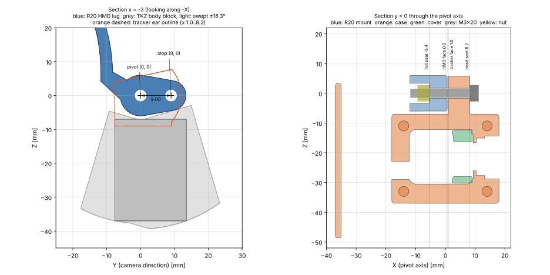
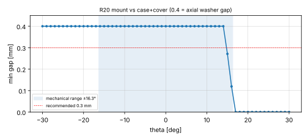

# Mouthtrap Mount Interface (MMI) v0.1 — specification

Status: **provisional (v0.1)**. Machine-readable values: [`mmi-v0.1.json`](mmi-v0.1.json). OpenSCAD library: [`cad/mmi.scad`](cad/mmi.scad).

MMI v0.1 is the joint between an **HMD mount** (one per headset) and the **tracker module** (camera case and cover, shared by all headsets). It is the joint that R20 already uses, written down so that new mounts can be made without touching the tracker module.

The reference implementations are the R20 parts in [`../stl`](../stl): `CentralMount.stl` (HMD side, Meta Quest 3S) and `CameraCaseWithAdapter.stl` + `CameraCover.stl` (tracker side). Every value below was checked against those STLs. All checks in this document are **CAD/mesh checks**. Nothing here has been confirmed by printing, fitting real fasteners, wearing a headset, load tests or camera field-of-view tests.

## 1. Joint overview

A two-bolt pitch hinge with both bolts parallel to the pivot axis:

- The **HMD side** carries a fixed *lug* with two Ø3.4 bores 9 mm apart and two hex pockets that hold M3 nylon-insert lock nuts.
- The **tracker side** carries a moving *ear* with a Ø3.4 pivot bore and an arc slot (radius 9, ±15°) for the stop bolt.
- Two M3×20 socket head cap screws go in from the ear side. The pivot bolt is the hinge axis; tightening the stop bolt clamps the angle. A 0.5 mm silicone pad sits in the 0.4 mm gap between the two faces.

The HMD side only has to provide two holes, two nut pockets and a flat face. Angle adjustment, the camera, the electronics and cable exits all belong to the tracker module.

| Responsibility | HMD side (mount) | Tracker side (module) |
|---|---|---|
| Headset attachment, strap or shell shape | ✔ | |
| Lug: bores, nut pockets, mating face | ✔ | |
| Ear: pivot bore, arc slot, head seats | | ✔ |
| Angle adjustment range | | ✔ (slot) |
| Camera, lens position, XIAO holder, cover | | ✔ |
| Cable and antenna exits | | ✔ (must stay inside the TKZ) |
| Staying out of the tracker keep-out zone | ✔ | |
| Staying inside the tracker keep-out zone | | ✔ |

## 2. Coordinate system

| | Definition |
|---|---|
| Origin O | On the pivot axis, on the tracker module's symmetry plane. In the R20 generator this is the point `PIVOT = (0, −116, −91)` of the headset model; MMI coordinates = R20 world coordinates − PIVOT. |
| +X | Along the pivot axis, from the HMD lug towards the tracker ear. Bolts are inserted towards −X. |
| +Y | Camera viewing direction at θ = 0. |
| +Z | X × Y; up at nominal wear. |
| θ | Rotation of the tracker module about +X (right-hand rule). +θ swings the lens towards +Y. θ = 0 is the R20 nominal angle. |

The frame is fixed by the hardware, not by the wearer: whether +X is the wearer's left or right depends on how a mount places the joint.

## 3. Dimensions

"Required" values are what [`tests/verify_mount.py`](tests/verify_mount.py) checks. "R20 nominal" is from the R20 FreeCAD generator scripts (not in this repository). "R20 STL" is measured from the files in `../stl` (see [`reference/r20_measurements.json`](reference/r20_measurements.json)); the bores are 252-sided polygons, so their area-equivalent diameter is 3.3993.

### 3.1 HMD side

| Feature | Required | R20 nominal | R20 STL |
|---|---|---|---|
| Pivot axis (y, z) | (0, 0) ± 0.05 | (0, 0) | (0.000, 0.000) |
| Stop axis (y, z) | (9, 0) ± 0.05 | (9, 0) | (9.000, 0.000) |
| Mating face (plane x =) | 0.6 ± 0.05 | 0.6 | 0.600 |
| Nut seat (plane x =) | −5.4 ± 0.1 | −5.4 | −5.400 |
| Bore diameter, both axes, from seat to face | 3.35 … 3.6 (3.4 nominal) | 3.4 | 3.399 |
| Nut pocket across flats | 5.7 … 5.95 (5.8 nominal) | 5.8 | 5.800 (corners 6.697) |
| Nut pocket depth below the seat | ≥ 4.3, open towards −X | 6.6 (to x = −12.0) | open to x = −12.0 |
| Nut pocket clocking | free | flats normal to Y | flats normal to Y |
| Solid seat under the nut (5.5 AF ring) | ≥ 95 % | — | 100 % |
| Flat bearing area on the face | r ≥ 5.0 around pivot, r ≥ 3.5 around stop, ≥ 98 % | lobes r 6.0 / 4.4, front fillet R0.8 | 100 % / 100 % |
| Lug outline beyond the bearing areas | free (must respect §5) | tangent hull of the two lobes | — |
| Pocket wall (recommended) | ≥ 0.85 (two perimeters, 0.4 nozzle) | — | 2.65 / 1.05 |

### 3.2 Tracker side

| Feature | Required | R20 nominal | R20 STL |
|---|---|---|---|
| Ear mating face (plane x =) | 1.0 ± 0.05 | 1.0 | 1.000 |
| Ear outer face / bolt head seat | 8.2 ± 0.05 | 8.2 | 8.200 |
| Pivot bore | free Ø3.35 | Ø3.4 | 3.399 |
| Stop slot | radius 7.3 … 10.7, end centres ±15°, end radius 1.7 | same | open from 7.30 to 10.69 at θ = 0; open ±25.8° along r = 9 (end rounds included) |
| Envelope | inside the TKZ (§5.1) at θ = 0 | — | 0.000 mm³ outside |

### 3.3 Stack-up and fasteners

| Item | Value |
|---|---|
| Bolt | M3 × 20 socket head cap screw (ISO 4762), 2 per joint |
| Nut | M3 nylon-insert lock nut, DIN 985, 5.5 AF, height ≤ 4.0 |
| Axial gap between faces | 0.4 (filled by a 0.5 mm silicone pad, R20 practice) |
| Grip, head seat to nut seat | 8.2 − (−5.4) = **13.6** |
| Bolt tip | x = −11.8, 2.4 mm past a 4.0 mm nut |
| Tool | 2.5 mm hex key from +X |

Changing the nut seat plane or the ear thickness changes the bolt length, so both are fixed. An M3 flat washer (0.5 mm) under the stop bolt head would spread the clamp load on the narrow slot land (1.05 mm each side); the bolt would still pass the nut by 1.9 mm. This is a suggestion only and has not been tried.

## 4. Hinge range

- The slot ends are at ±15°. An M3 shank (r 1.5) in the r 1.7 slot ends reaches **±16.27°**: this is the mechanical range.
- With the real R20 meshes, the case first touches the mount at **+16.82°** (case top edge near y 9–11, z −4.5, against the lug below the stop lobe). In the negative direction nothing touches before −57°.
- R20 is therefore collision-free over its whole mechanical range, but the margin at the positive end is small: **0.27 mm at +15°** and **0.074 mm at +16.3°** (graph below; 0.4 is the axial washer gap). Printed parts and the silicone pad may close this. Check it on the real part before relying on the last degree of travel.

## 5. Keep-out zones

### 5.1 Tracker keep-out zone (TKZ)

The TKZ is the space every conforming tracker module may use and no mount may enter. It is built from simple prisms along X, each swept about X over **θ ∈ [−16.3°, +16.3°]**:

| Block | x | y | z | Contains in R20 |
|---|---|---|---|---|
| body | −18 … 18 | −7.6 … 13.5 | −37 … −7 | case and cover |
| front_fasteners | −17 … 17 | 13.5 … 15.8 | −36 … −8 | the four cover screw heads |
| ear | 1.0 … 8.2 | profile: (−7.6, −9), (9.19, −9), arc r 12 from −40° to +40°, (−7.6, 4.0) | | ear, stop sector, hinge web |
| antenna | −37 … −14 | −7.6 … 11.4 | −49 … 3.7 | antenna pad and its two braces |
| usb_cable | 18 … 38 | −6 … 6.5 | −31 … −12 | allowance for a USB-C plug and bend |

The usb_cable block is a reserved allowance, not a measurement of a particular cable. The antenna pad sits on the pivot axis line at x −37 … −35, so the nuts must be in their pockets before the tracker is fitted.

`mmi_tkz()` in the OpenSCAD library and `mmi.tkz()` in the Python checks produce the same solid (symmetric difference 0.18 mm³ of 88 069 mm³, from Clipper rounding).

### 5.2 Fastener and gap zones (HMD frame, not swept)

| Zone | Shape | Rule |
|---|---|---|
| Shanks | r 1.5, x −11.8 … 8.2, both axes | empty |
| Heads and key access | r 3.0, x 8.2 … 41.2, both axes | empty |
| Nut insertion | 5.7 AF hex from the seat to beyond the mount, both axes | empty |
| Washer gap | ear profile, x 0.6 … 1.0, swept like the TKZ | empty |

### 5.3 Clearance

A mount must not intersect the TKZ (required). A gap of **≥ 0.3 mm** to the TKZ is recommended. R20 has 0.06 mm (sampled TKZ) and is accepted as the reference with a warning. `mmi_hmd_part(clearance = 0.3)` trims new mounts automatically; with that trim the stop-pocket wall under the lobe is 0.94 mm.

## 6. Conformance

A part conforms to MMI v0.1 when every **required** check passes:

| Check id | Side | Meaning |
|---|---|---|
| `mesh.valid` | both | closed, consistently wound, single body |
| `pivot.bore`, `stop.bore` | HMD | §3.1 bore diameter and position |
| `*.seat_and_face` | HMD | §3.1 seat and face planes (also reports the grip) |
| `*.nut_pocket` | HMD | min-AF hex fits 4.3 deep and is insertable from outside |
| `*.seat_fill`, `*.bearing_fill` | HMD | solid seat and bearing face |
| `washer_gap.empty`, `fastener_zone.*` | HMD | §5.2 |
| `tkz.no_intersection` | HMD | §5.1 |
| `tkz.contained`, `ear.*` | tracker | §3.2 |

Recommended (warnings): `tkz.clearance` ≥ 0.3, `*.pocket_wall` ≥ 0.85. `r20_tracker_sweep` is informational: it sweeps the real R20 case and cover through the mechanical range and records the gap at each angle.

Conformance says the CAD fits. Support status is tracked separately in [`../README.md`](../README.md):

| Status | Meaning |
|---|---|
| Designed | Conforms to MMI v0.1 in CAD (checks above pass) |
| Test-printed | Printed; the fit coupon and the mount accept the bolts, nuts and an R20 tracker |
| Verified on HMD | Worn on the named headset; stays put, does not touch the face, the camera sees the mouth, and the software tracks |

## 7. Tolerances and printing

The values above are CAD values. FDM holes usually print undersize and vary between printers and filaments, which is why the bore range is wider than the CAD tolerance. Print [`cad/mmi_fit_coupon.scad`](cad/mmi_fit_coupon.scad) first: both coupons print mating face down with no supports and need no headset. No printed measurements have been recorded for v0.1 yet.

## 8. Is the R20 joint suitable as a standard?

Measured against the requirements of a shared interface, R20 is kept as it is:

- **Small HMD-side surface.** The mount only needs two holes, two pockets and a face. The slot, and so the adjustment range, belongs to the tracker. A new headset never needs to change the angle mechanism.
- **One fastener size.** The same M3×20 + DIN 985 nut is used for the cover, so no new hardware is needed.
- **Exact and repeatable.** Bores, faces and seats are planar or cylindrical and parallel to one axis, so they can be checked numerically from an STL.

Weak points found, and how v0.1 handles them without changing R20:

| Finding | Handling in v0.1 |
|---|---|
| 0.27 mm clearance at +15°, 0.074 mm at +16.3° | Required: no intersection (R20 passes). Recommended: 0.3 mm; the template applies it. |
| The tracker's volume was not defined, so a future case could hit an existing mount | The TKZ reserves a fixed volume. R20 sits inside it; mounts stay outside it. |
| The antenna pad lies on the bolt axis line | Nut insertion is specified from −X before the tracker is fitted (§5.1). |
| The slot land under the stop bolt head is 1.05 mm | Optional washer suggested, untested (§3.3). |
| The lug fillets (R0.8 front, R0.3 back) are not part of the interface | The library lug omits them (6.9 mm³ more material than R20, outside the bearing areas); either conforms. |

No compatibility adapter is needed for R20, so none is provided.

## 9. Versioning and future tracker revisions (R21+)

- **Tracker revisions conform to v0.1** as long as their ear matches §3.2 and the whole module stays inside the TKZ over the mechanical range. The camera, board, cover, antenna and cable layout can change freely inside the TKZ. Every v0.1 mount then fits without changes.
- **HMD mounts conform to v0.1** when they pass §6. They fit every v0.1 tracker.
- A change that could make a conforming part stop conforming is **breaking**: moving or resizing a bore, face, seat or slot; changing the bolt; enlarging the TKZ or the sweep range. While the version is 0.x, a breaking change bumps the minor version (0.2). From 1.0 it bumps the major version. Breaking versions keep their own `mmi-v<version>.json` and checks; parts declare the version they target.
- Additions that do not affect existing parts (an optional tether anchor, a cable clip zone outside the TKZ, extra tests) are non-breaking and bump the patch version (0.1.1) before 1.0.
- Proposals go through a pull request that changes `mmi-v<version>.json`, `cad/mmi.scad`, this document and the tests together; `tests/test_scad.py` fails if the JSON and the OpenSCAD library disagree.

## Appendix A. Camera reference (informative)

At θ = 0 the R20 lens aperture is centred at (x, z) = (5.54, −22.0), measured from `CameraCover.stl`, and opens along +Y from Ø9.5 at y 12 to Ø10.9 at y 13.4. The optical axis turns with θ. Use this to aim the camera at the mouth when you place the joint on a new headset; it is not part of the interface and may change in later tracker revisions.

## Appendix B. How the values were obtained

- The STLs in `../stl` are byte-identical to the R20 delivery of 2026-11-23 (SHA-256 in [`reference/r20_registration.json`](reference/r20_registration.json)).
- They were registered into the MMI frame from the generator's export rotations and the STEP bounding boxes; the surface distance between the registered STLs and the R20 STEP files is at most 0.0041 mm near the hinge. The STEP files and generator scripts were used locally for this and are not in the repository.
- Sections, rays and booleans: trimesh, shapely and manifold3d (versions in [`tests/requirements.txt`](tests/requirements.txt)). Rerun with `python tests/run_all.py`.
